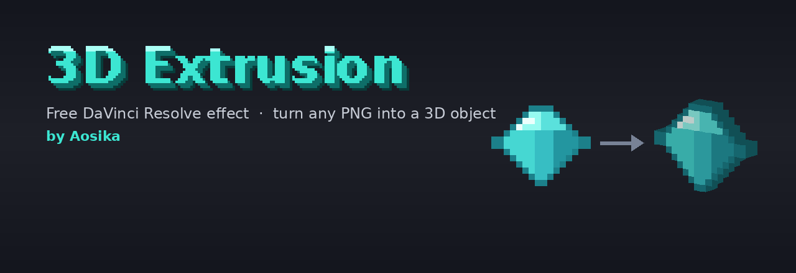
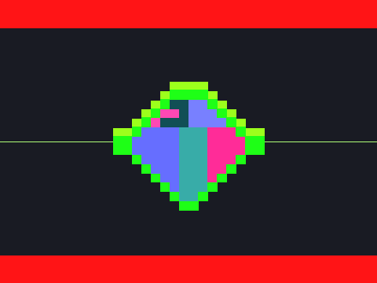
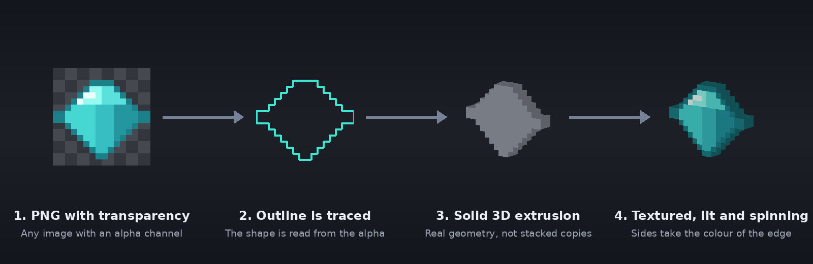
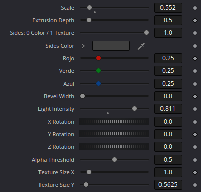
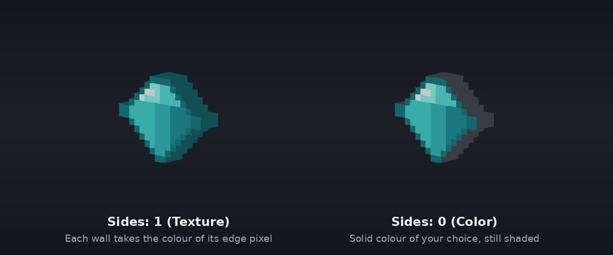
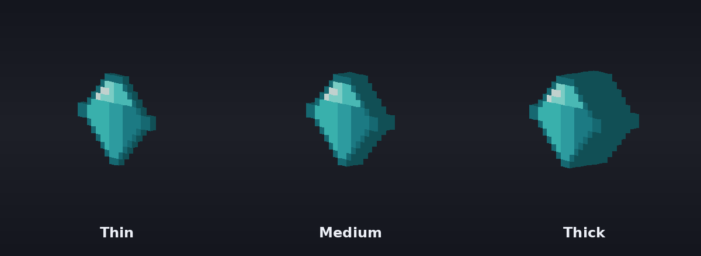
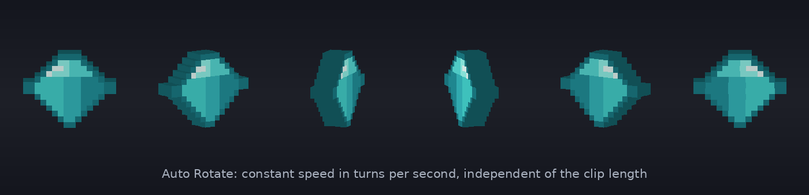

# 3D Extrusion – Aosika

**Un efecto gratuito para DaVinci Resolve que convierte cualquier PNG con transparencia en un objeto 3D sólido de verdad.**
Lo arrastras al clip, eliges la profundidad y lo pones a girar. Los lados toman el color de los bordes de la imagen,
así que el pixel art, los iconos, los logos y las pegatinas parecen piezas 3D reales y no tarjetas planas.

🇬🇧 [Read in English](README.md)

---

## Características

- **Extrusión real.** El contorno de la imagen se convierte en geometría 3D con paredes laterales continuas.
- **Lados con textura.** Cada pared toma el color del píxel de su borde, o puedes usar un color sólido.
- **Iluminación.** Luz ambiental y luz principal integradas, para que los lados tengan sombreado y se note el volumen.
- **Giro automático.** Una casilla para que gire sin parar a velocidad constante (vueltas por segundo), dure lo que dure el clip.
- **Rotación manual** en X, Y y Z, que puedes animar con keyframes como cualquier otro control.
- **Bisel opcional**, umbral de alfa y controles de alineación de la textura.
- Funciona en la **página Edición** como un efecto normal, con su propio icono en la biblioteca de efectos.

## Requisitos

- **DaVinci Resolve 21 o posterior** (gratuito o Studio).
  El efecto usa herramientas que no existen en versiones anteriores. En Resolve 20 o anteriores no se carga bien.
- Probado en DaVinci Resolve 21.2 (gratuito) en Linux. En Windows y macOS debería funcionar igual, pero todavía no se ha probado. Cualquier aviso es bienvenido.

## Instalación

### Opción 1 – Paquete (recomendada)

1. Descarga **`3D-Extrusion-Aosika.drfx`** desde [Releases](../../releases) (o desde la carpeta [`release`](release)).
2. Con DaVinci Resolve abierto, haz doble clic en el archivo `.drfx` o arrástralo a la ventana de Resolve, y confirma la instalación.
3. Reinicia DaVinci Resolve.

### Opción 2 – Manual

Copia todos los archivos de [`src/Edit/Effects`](src/Edit/Effects) (el `.setting` y todos los iconos `.png`) en:

| Sistema | Carpeta |
|---|---|
| Windows | `C:\Users\<TuUsuario>\AppData\Roaming\Blackmagic Design\DaVinci Resolve\Support\Fusion\Templates\Edit\Effects\` |
| macOS | `/Users/<TuUsuario>/Library/Application Support/Blackmagic Design/DaVinci Resolve/Fusion/Templates/Edit/Effects/` |
| Linux | `~/.local/share/DaVinciResolve/Fusion/Templates/Edit/Effects/` |

Si las carpetas `Edit/Effects` no existen, créalas. Después reinicia Resolve.

> Truco: en la página Fusion, abre la biblioteca de efectos, entra en *Templates* y usa **⋯ → Show Folder** para abrir directamente la carpeta correcta.

## Cómo se usa

1. Pon tu PNG (o cualquier clip con canal alfa) en la línea de tiempo.
2. Abre **Efectos → Caja de herramientas → Efectos de vídeo → Efectos Fusion** (o busca *3D Extrusion*).
3. Arrastra **3D Extrusion – Aosika** encima del clip.
4. Selecciona el clip y ajusta los controles en el **Inspector**.

Para empezar: **Extrusion Depth** a 0.5, **Y Rotation** a 30, y marca **Auto Rotate**.

## Controles

| Control | Por defecto | Qué hace |
|---|---|---|
| **Scale** | 1 | Tamaño general del objeto. |
| **Extrusion Depth** | 0.5 | Grosor del objeto. Cuanto más alto, más profundo. |
| **Sides: 0 Color / 1 Texture** | 1 | `1` = los lados toman los colores de los bordes de la imagen. `0` = los lados usan *Sides Color*. |
| **Sides Color** | gris oscuro | Color de los lados cuando *Sides* está en `0`. |
| **Bevel Width** | 0 | Redondea o bisela los bordes. Déjalo en 0 para pixel art nítido. |
| **Light Intensity** | 0.4 | Fuerza de la luz principal. Súbela para más contraste entre el frente y los lados. |
| **X / Y / Z Rotation** | 0 | Rotación fija del objeto. Se puede animar con keyframes. |
| **Alpha Threshold** | 0.5 | Qué opacidad necesita un píxel para formar parte de la forma. Bájalo para incluir bordes suaves y súbelo para recortarlos. |
| **Texture Size X / Y** | 1 / 0.5625 | Alineación de la textura con la forma. Solo hay que tocarlo si tu línea de tiempo no es 16:9 (ver abajo). |
| **Auto Rotate** | desactivado | Hace girar el objeto sobre el eje Y automáticamente. |
| **Rotation Speed (turns/sec)** | 0.5 | Velocidad de giro. 0.5 = una vuelta cada 2 segundos. Con valores negativos gira al revés. |

## Consejos

- **Pixel art / sprites de juegos:** amplía las imágenes pequeñas (16×16, 32×32…) a unos 512×512 con escalado *vecino más próximo* (nearest neighbour) antes de importarlas. Resolve suaviza las imágenes pequeñas al escalarlas y eso redondea el contorno.
- **Líneas de tiempo que no son 16:9:** pon en **Texture Size Y** el *alto ÷ ancho* de tu línea de tiempo. Por ejemplo 1 para formato cuadrado y 1.7778 para vídeo vertical 9:16.
- **Giro más pose:** usa *X/Y/Z Rotation* para el ángulo de partida y *Auto Rotate* para el movimiento. Se suman.
- **Reproducción fluida:** clic derecho en el clip → **Render Cache Fusion Output → On**, o usa **Render in Place** cuando tengas el resultado que quieres. Al exportar, si necesitas transparencia, usa un códec con alfa (por ejemplo *Apple ProRes 4444*).

## Limitaciones

- **La reproducción puede ir pesada.** El contorno y la malla 3D se reconstruyen en cada fotograma, así que en equipos modestos la reproducción en tiempo real puede saltarse fotogramas. Al renderizar no pasa. Mientras editas, usa la caché o *Render in Place*.
- **Funciona mejor con siluetas limpias.** Las imágenes con bordes de alfa duros (pixel art, iconos, logos, pegatinas recortadas) dan el mejor resultado. Los bordes muy suaves o semitransparentes, los brillos y las sombras se cortan según el *Alpha Threshold*.
- **Los lados se colorean con los píxeles del borde.** Si tu imagen tiene un contorno oscuro, los lados saldrán oscuros. Pon *Sides* en `0` para usar un color sólido.
- **Las imágenes muy detalladas o con ruido** generan mucha geometría y van lentas.
- **Auto Rotate solo gira sobre el eje Y.** Para otros ejes, anima *X* o *Z Rotation* con keyframes.
- **Necesita DaVinci Resolve 21 o posterior.**

## Solución de problemas

| Problema | Solución |
|---|---|
| El efecto no aparece en la biblioteca | Reinicia Resolve después de instalarlo. Comprueba que los archivos están dentro de `Templates/Edit/Effects`. |
| El objeto se ve plano | Sube *Extrusion Depth* y pon algo de *Y Rotation* para ver los lados. |
| La textura se ve desplazada o estirada | Seguramente tu línea de tiempo no es 16:9. Ajusta *Texture Size Y* (ver Consejos). |
| Los bordes salen dentados o redondeados | Usa una imagen de origen más grande (ampliada con vecino más próximo). |
| La reproducción va a saltos | Activa *Render Cache Fusion Output* en el clip, o baja la resolución de proxy de la línea de tiempo. |

## Registro de cambios

Ver [CHANGELOG.md](CHANGELOG.md).

## Licencia

Libre para proyectos personales y comerciales. Publicado bajo [licencia MIT](LICENSE).
Se agradece una mención o un enlace, pero no es obligatorio.

---

Hecho por **Aosika**.
