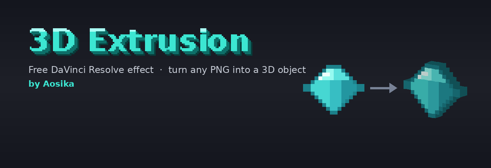
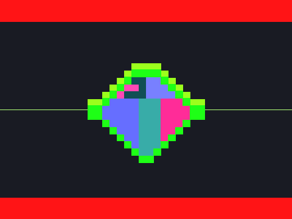
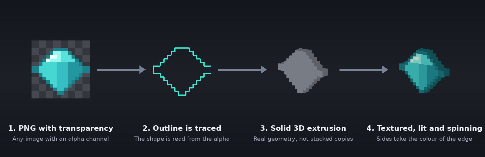
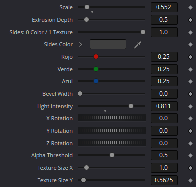
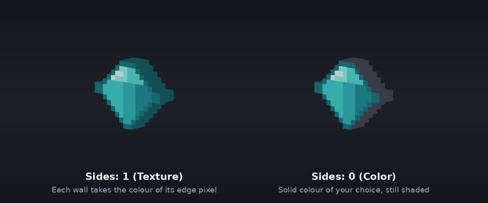
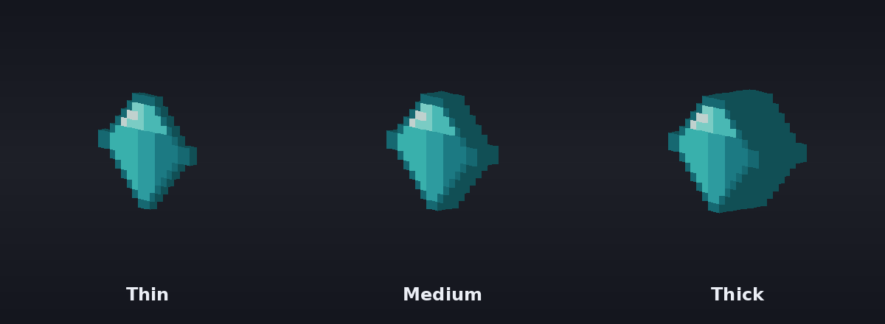
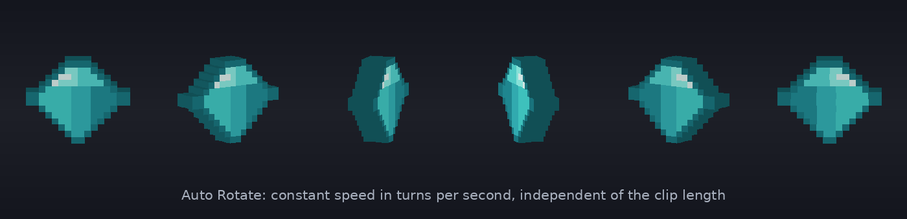

# 3D Extrusion – Aosika

**A free effect for DaVinci Resolve that turns any PNG with transparency into a real, solid 3D object.**
Drop it on a clip, set the depth, and spin it. The sides pick up the colours of the image edges, so pixel art,
icons, logos and stickers look like proper 3D pieces instead of flat cards.

🇪🇸 [Leer en español](README.es.md)

---

## Features

- **Real extrusion.** The outline of your image becomes actual 3D geometry with continuous side walls.
- **Textured sides.** Each wall takes the colour of the pixel on its edge, or use a single solid colour.
- **Lighting.** Built-in ambient and key lights give the sides shading so the volume reads clearly.
- **Auto Rotate.** One checkbox for a continuous spin at a constant speed (turns per second), however long the clip is.
- **Manual rotation** on X, Y and Z, which you can keyframe like any other control.
- **Optional bevel**, alpha threshold and texture alignment controls.
- Works on the **Edit page** as a regular effect, with its own icon in the Effects Library.

## Requirements

- **DaVinci Resolve 21 or newer** (free or Studio).
  The effect relies on tools that are not available in older versions. On Resolve 20 or earlier it will not load correctly.
- Tested on DaVinci Resolve 21.2 (free) on Linux. It should behave the same on Windows and macOS, but those haven't been tested yet. Reports are welcome.

## Installation

### Option 1 – Bundle (recommended)

1. Download **`3D-Extrusion-Aosika.drfx`** from the [Releases](../../releases) page (or from the [`release`](release) folder).
2. With DaVinci Resolve open, double-click the `.drfx` file or drag it onto the Resolve window, and confirm the installation.
3. Restart DaVinci Resolve.

### Option 2 – Manual

Copy every file inside [`src/Edit/Effects`](src/Edit/Effects) (the `.setting` file and all the `.png` icons) into:

| System | Folder |
|---|---|
| Windows | `C:\Users\<YourUser>\AppData\Roaming\Blackmagic Design\DaVinci Resolve\Support\Fusion\Templates\Edit\Effects\` |
| macOS | `/Users/<YourUser>/Library/Application Support/Blackmagic Design/DaVinci Resolve/Fusion/Templates/Edit/Effects/` |
| Linux | `~/.local/share/DaVinciResolve/Fusion/Templates/Edit/Effects/` |

Create the `Edit/Effects` folders if they don't exist, then restart Resolve.

> Tip: on the Fusion page, open the Effects Library, go to *Templates*, and use **⋯ → Show Folder** to open the right folder directly.

## How to use

1. Put your PNG (or any clip with an alpha channel) on the timeline.
2. Open **Effects → Toolbox → Effects → Fusion Effects** (or search for *3D Extrusion*).
3. Drag **3D Extrusion – Aosika** onto the clip.
4. Select the clip and adjust the controls in the **Inspector**.

A good starting point: **Extrusion Depth** 0.5, **Y Rotation** 30, then tick **Auto Rotate**.

## Controls

| Control | Default | What it does |
|---|---|---|
| **Scale** | 1 | Overall size of the object. |
| **Extrusion Depth** | 0.5 | Thickness of the object. Higher values make it deeper. |
| **Sides: 0 Color / 1 Texture** | 1 | `1` = sides take the colours of the image edges. `0` = sides use *Sides Color*. |
| **Sides Color** | dark grey | Colour of the sides when *Sides* is set to `0`. |
| **Bevel Width** | 0 | Rounds/chamfers the edges. Keep it at 0 for crisp pixel art. |
| **Light Intensity** | 0.4 | Strength of the key light. Raise it for more contrast between the front and the sides. |
| **X / Y / Z Rotation** | 0 | Fixed rotation of the object. Can be keyframed. |
| **Alpha Threshold** | 0.5 | How opaque a pixel must be to count as part of the shape. Lower it to include soft edges, raise it to cut them. |
| **Texture Size X / Y** | 1 / 0.5625 | Alignment of the texture with the shape. Only change these if your timeline is not 16:9 (see below). |
| **Auto Rotate** | off | Spins the object around Y automatically. |
| **Rotation Speed (turns/sec)** | 0.5 | Spin speed. 0.5 = one turn every 2 seconds. Negative values spin the other way. |

## Tips

- **Pixel art / game sprites:** upscale small images (16×16, 32×32…) to around 512×512 using *nearest neighbour* before importing them. Small images get blurred when Resolve scales them, which rounds off the traced outline.
- **Timelines that aren't 16:9:** set **Texture Size Y** to *height ÷ width* of your timeline. For example 1 for a square timeline and 1.7778 for 9:16 vertical video.
- **Spin plus pose:** use *X/Y/Z Rotation* to set the starting angle and *Auto Rotate* for the movement. They add up.
- **Smooth playback:** right-click the clip → **Render Cache Fusion Output → On**, or use **Render in Place** once you're happy with the result. When exporting, use a codec with alpha (for example *Apple ProRes 4444*) if you need transparency.

## Limitations

- **Playback can be heavy.** The outline and the 3D mesh are rebuilt on every frame, so real-time playback may drop frames on slower machines. Final renders aren't affected. Use the render cache or *Render in Place* while editing.
- **Works best with clean silhouettes.** Images with hard alpha edges (pixel art, icons, logos, cut-out stickers) give the best results. Very soft or semi-transparent edges, glows and shadows get cut at the *Alpha Threshold*.
- **Sides are coloured by the outermost pixels.** If your image has a dark outline, the sides will be dark too. Switch *Sides* to `0` for a solid colour instead.
- **Very detailed or noisy images** create a lot of geometry and render slowly.
- **Auto Rotate only spins around Y.** For other axes, keyframe *X* or *Z Rotation*.
- **Requires DaVinci Resolve 21 or newer.**

## Troubleshooting

| Problem | Fix |
|---|---|
| The effect doesn't appear in the library | Restart Resolve after installing. Check that the files are inside `Templates/Edit/Effects`. |
| The object looks flat | Increase *Extrusion Depth* and set some *Y Rotation* so you can see the sides. |
| The texture looks shifted or stretched | Your timeline probably isn't 16:9. Adjust *Texture Size Y* (see Tips). |
| Edges look jagged or rounded | Use a larger source image (upscaled with nearest neighbour). |
| Playback stutters | Turn on *Render Cache Fusion Output* for the clip, or lower the timeline proxy resolution. |

## Changelog

See [CHANGELOG.md](CHANGELOG.md).

## License

Free to use in personal and commercial projects. Released under the [MIT License](LICENSE).
A credit or a link back is appreciated but not required.

---

Made by **Aosika**.
